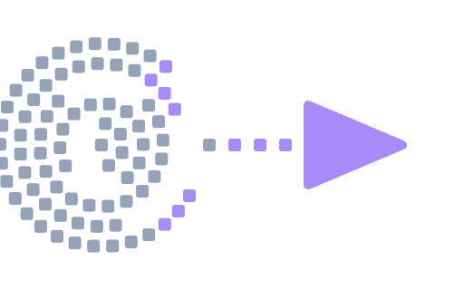

<div align="center">
  
  <h1>compid</h1>
  <p><strong>Shazam for compiled binaries - which compiler built this binary?</strong></p>
  <p>
    <a href="https://github.com/RXVEN-1907/compid/actions/workflows/ci.yml"></a>
    <a href="LICENSE"></a>
    <a href="https://www.rust-lang.org"></a>
  </p>
</div>

---

You hand `compid` a binary - possibly stripped, possibly renamed, possibly
deliberately anonymous - and it hands back an estimate of how that binary was
built: compiler family, compiler version, optimization level, architecture,
OS, libc flavor, and whether the result is position-independent,
link-time-optimized, or statically linked. Every estimate carries a confidence
score, and every score is grounded in a build-fingerprint dataset the project
generates itself: build a corpus of small programs across a matrix of
toolchains and flags, fingerprint every binary, train one linear model per
label field, and ship the model with the tool.

The dataset grows, and the tooling for growing it is part of the repository.
The pipeline is the product.

The inference path is a single Rust binary. It parses the ELF with
[goblin](https://docs.rs/goblin), disassembles `.text` with
[yaxpeax-x86](https://docs.rs/yaxpeax-x86), and scores a compact `model.json`
you can read with a text editor. No Python, no services, no network calls.

## Why it exists

"Which compiler built this?" is step zero for a surprising amount of work:

- **Malware triage.** A sample set that consistently looks like gcc `-O2`
  builds tells you something about who made it and what tooling to expect
  next.
- **Reverse engineering.** Knowing the compiler, optimization level, and libc
  picks the right signatures, the right decompiler settings, and the right
  assumptions about calling conventions before you touch a function.
- **Reproducible-build forensics.** Given two artifacts claimed to come from
  the same source tree, provenance estimates are a cheap first check that the
  toolchains involved line up.

Today that question is answered by hand: eyeballing prologues, string scraps,
and section layouts, or reaching for signature packs that live inside one
specific disassembler. `compid` turns the habit into a measured, reproducible
guess that costs one command - and it tells you how confident it is, which is
the part a hunch never does.

## Quickstart

Rust 1.75 or newer, on Linux or macOS. The classifier runs on any architecture
Rust compiles for; today it reads ELF files.

```console
$ cargo install --path .
```

Two commands to start with - classify a binary, then ask why:

```console
$ compid classify /tmp/sample
binary: /tmp/sample
model:   model/model.json (trained 2026-10-20, 6253 features)
build-id: d1294f531713bb3802b7f5a57fe5c1e6ab895e3f

compiler_family
  0. gcc    99.96%  ####################
  1. clang   0.04%

compiler_version
  0. 13.3.0  99.96%  ####################
  1. 19.1.7   0.04%

opt_level
  0. O0    85.12%  #################
  1. O2     7.97%  ##
  2. Os     3.95%  #

pie
  0. no-pie  87.97%  ##################
  1. pie     12.03%  ##
```

That sample is a real binary from the seed dataset (gcc 13.3.0, -O0, no-PIE);
`arch`, `abi`, `lto`, and `static` all land above 99.9% on the same run, and
the table above is elided to the interesting fields.

```console
$ compid explain /tmp/sample
arch: x86_64 (100.0% confidence)
  top contributing features:
    ng:000000      +2.9837  (tf=45)
    ng:000048      +0.3751  (tf=12)
    mn:mov         +0.3703  (tf=17)
    rg:rax         +0.3056  (tf=25)
```

See [`examples/demo-transcript.md`](examples/demo-transcript.md) for a fuller
real session and [`docs/cli.md`](docs/cli.md) for every subcommand and
flag - `compid --help` always describes the exact CLI you have installed.

`classify` needs a model; the repository ships `model/model.json` trained on
the current seed matrix, and `--model` points it at any other model file.

## How it works

Four stages, all local:

1. **Build matrix.** The corpus builder compiles small seed programs with
   every toolchain and flag combination the build machine supports -
   optimization levels, PIE on/off, LTO on/off, static/dynamic linking,
   gnu/musl libc.
2. **Extraction.** `compid extract` turns each binary into one JSON object of
   integer counts over `.text`: byte n-grams, mnemonics, registers,
   immediates, section sizes, per-section entropy, clean-disassembly windows,
   and tokens from comment and note string sections.
3. **Training.** The Python trainer L2-normalizes those count vectors and
   fits one multinomial logistic-regression model per label field.
4. **Inference.** `compid classify` normalizes the same way, computes
   `intercept + dot(coef, x)` per class, applies a softmax over the scores,
   and reports the top-3 classes per field.

The longer version, with a pipeline diagram: [`docs/architecture.md`](docs/architecture.md).

## The seed dataset

Honesty first: the seed matrix is exactly what this machine could build on the
day the dataset was generated - the system gcc, plus a zig `cc` driver for
clang-family builds with musl and aarch64 cross-targets where available. It is
a start, not a benchmark. Predictions are only as good as the matrix behind
them, and a binary built by a toolchain the seed never saw will get confident
wrong answers.

Evaluation on the current seed is tracked in the table below, filled from
reproducible held-out runs of the trainer (80/20 stratified split, seed 42).
The full report - per-class breakdowns, baselines, and the honest weak
spots - lives in [`docs/EVALUATION.md`](docs/EVALUATION.md).

| field | classes | rows | top-1 | top-3 |
|-------|---------|------|-------|-------|
| compiler_family | 2 | 751 | 1.0000 | 1.0000 |
| compiler_version | 2 | 751 | 1.0000 | 1.0000 |
| opt_level | 6 | 751 | 0.8411 | 0.9934 |
| arch | 2 | 751 | 1.0000 | 1.0000 |
| os | 1 | 751 | - | not modeled |
| abi | 2 | 751 | 1.0000 | 1.0000 |
| pie | 2 | 751 | 1.0000 | 1.0000 |
| lto | 2 | 751 | 0.9338 | 1.0000 |
| static | 2 | 751 | 0.9934 | 1.0000 |

`os` is not modeled because the ELF-only seed contains a single class
(linux); `lto` sits at its majority baseline until the matrix gains more
LTO-built rows.

## Expanding the matrix

Every row of the dataset is one (source, toolchain, flags) build recorded in
`dataset/manifest.csv`. Adding a row is: add or enable a toolchain, let the
corpus builder do its thing, re-run the trainer. New source programs, new
compilers, and new flag axes all follow the same recipe - documented in
[`corpus/README.md`](corpus/README.md) with format details in
[`docs/dataset.md`](docs/dataset.md).

## How compid compares

FLIRT, from IDA Pro, answers a related but different question - which
*library function* is this - by matching byte signatures against IDA's own
library packs, and it lives inside IDA. BinDiff *diffs* two binaries you
already know something about; it does not guess provenance. The academic
compiler-fingerprinting literature produces interesting datasets, but they are
research artifacts: frozen at publication time, rarely maintained, and seldom
shipped as a tool you can run on yesterday's sample. `compid` makes a
different bet: generate the dataset from the toolchains you actually care
about, keep the model small and interpretable, and make the whole loop -
build, extract, train, classify - something you can re-run end to end. None
of these tools conflict; compid is a first pass that the heavier ones can sit
on top of.

## Roadmap

The near list, from [`docs/roadmap.md`](docs/roadmap.md):

- PE and Mach-O support, so the same classifier covers Windows and macOS
  artifacts
- more architectures - riscv64 and arm32 alongside x86-64 and aarch64
- function-level classification, not just whole-binary
- Ghidra and IDA plugins that load `model.json` directly
- online model updates without a full retrain

## Repository layout

```
compid/
├── src/         Rust: extractor, model reader, the six subcommands
├── corpus/      Python: builds the seed matrix on the current machine
├── training/    Python: turns manifest + features into model.json
├── dataset/     manifest.csv (committed), binaries/ (local), features/ (committed)
├── model/       model.json (committed)
├── docs/        architecture, dataset, model format, roadmap, CLI
├── examples/    illustrative demo session
├── tests/       cargo tests and fixtures
└── scripts/     small helpers
```

## Contributing

Bug reports, dataset expansion, and documentation fixes are all welcome - see
[`CONTRIBUTING.md`](CONTRIBUTING.md) for the setup and the ground rules.

## License

`compid` is dual-licensed under the MIT license or the Apache License,
Version 2.0, at your option - see [`LICENSE`](LICENSE).
