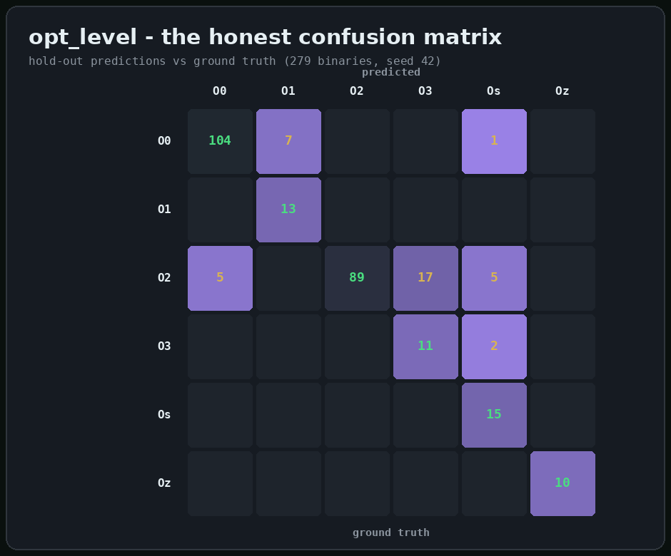
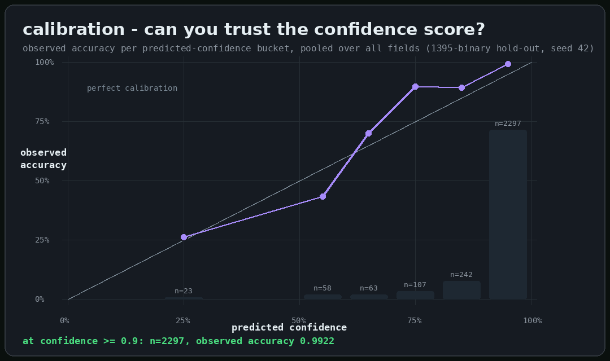
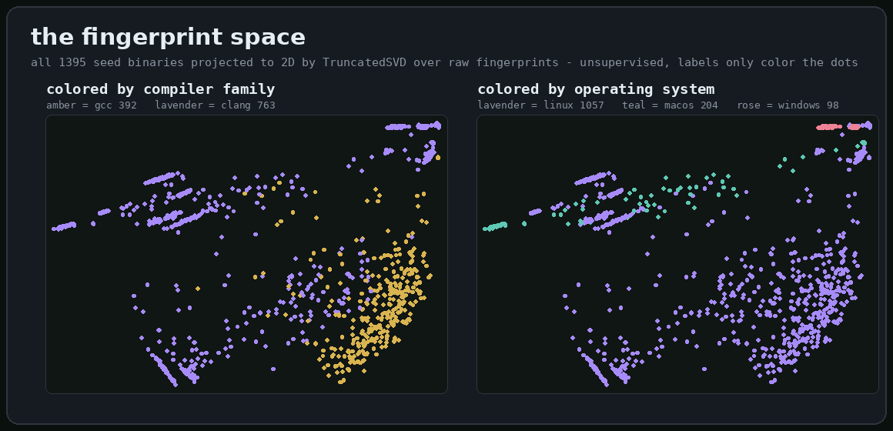
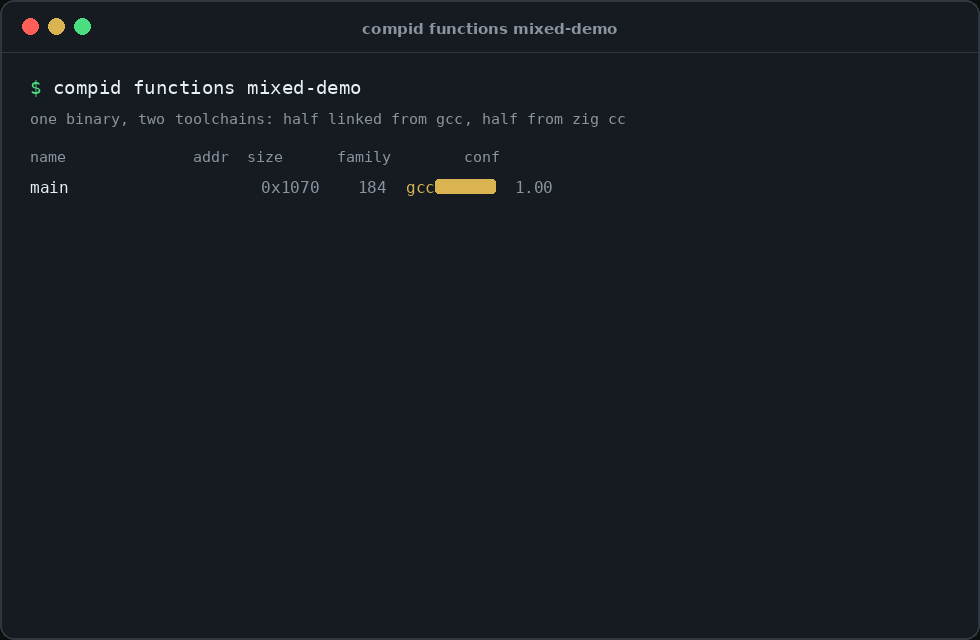
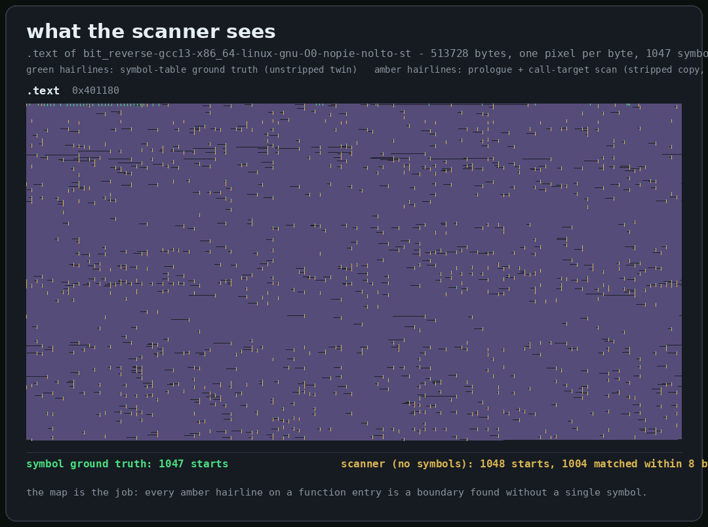

<div align="center">
  
  <h1>compid</h1>
  <p><strong>Shazam for compiled binaries - which compiler built this binary?</strong></p>
  <p>
    <a href="https://github.com/RXVEN-1907/compid/actions/workflows/ci.yml"></a>
    <a href="https://github.com/RXVEN-1907/compid/releases/latest"></a>
    <a href="https://github.com/RXVEN-1907/compid/releases/latest"></a>
    <a href="LICENSE"></a>
    <a href="https://www.rust-lang.org"></a>
    <a href="https://github.com/RXVEN-1907/compid/commits"></a>
  </p>
</div>

---

You hand `compid` a binary - possibly stripped, possibly renamed, possibly
deliberately anonymous - and it hands back an estimate of how that binary was
built: **compiler family, compiler version, optimization level, architecture,
OS, libc flavor, PIE, LTO, static linking, and hardening** - ten label fields,
each with a confidence score, each grounded in a build-fingerprint dataset the
project generates itself.

<div align="center"></div>

*The real output for a seed binary (gcc 13.3.0, -O0, no-PIE) - every field
lands correctly.*

## Why it exists

"Which compiler built this?" is step zero for a surprising amount of work:

- **Malware triage.** A sample set that consistently looks like gcc `-O2`
  builds tells you something about who made it and what tooling to expect
  next.
- **Reverse engineering.** Knowing the compiler, optimization level, and libc
  picks the right signatures, the right decompiler settings, and the right
  assumptions about calling conventions before you touch a function.
- **Reproducible-build forensics.** Given two artifacts claimed to come from
  the same source tree, provenance estimates are a cheap first check that the
  toolchains involved line up.
- **Mixed-binary audits.** Modern binaries are stitched together from
  vendored libraries built by different toolchains - `compid` reads them
  function by function.

Today that question is answered by hand: eyeballing prologues, string scraps,
and section layouts. `compid` turns the habit into a measured, reproducible
guess that costs one command - and it tells you how confident it is, which is
the part a hunch never does.

## Quickstart

Prebuilt binaries for Linux, Windows, macOS, FreeBSD, and NetBSD (x86-64,
arm64, arm32, riscv64, and more) are on the
[releases page](https://github.com/RXVEN-1907/compid/releases/latest) -
every archive is self-contained: the trained models ship *inside* the
binary, so unpack and classify from anywhere.

```console
$ compid classify suspicious.exe       # works immediately, no model files
```

Build from source instead (Rust 1.75+, Linux or macOS):

```console
$ cargo install --path .
$ compid classify /bin/ls
$ compid report /bin/ls          # one rich screen: classify + why + provenance
$ compid model-info              # what the shipped model knows and how fresh it is
```

Tables render in color automatically in terminals (lavender confidence bars,
green winners) and respect the [`NO_COLOR`](https://no-color.org) standard;
`--color never` forces plain output for scripts and pipes.

## Install

Tag pushes build and publish every artifact below automatically, each a
self-contained directory (binary with embedded models, shell completions,
man page, docs) with a combined `sha256sums` file on the release:

| platform | artifact |
|---|---|
| Linux x86-64 (glibc / musl static / 32-bit) | `x86_64-unknown-linux-{gnu,musl}` · `i686-unknown-linux-gnu` |
| Linux aarch64 | `aarch64-unknown-linux-{gnu,musl}` |
| Linux arm (32-bit) | `armv7-unknown-linux-gnueabihf` · `arm-unknown-linux-gnueabihf` |
| Linux riscv64 / loongarch64 / powerpc64le / s390x | same triple pattern |
| Windows x86-64 | `x86_64-pc-windows-msvc.zip` (MSVC) · `x86_64-pc-windows-gnu.zip` |
| Windows arm64 / 32-bit | `aarch64-pc-windows-gnullvm.zip` · `i686-pc-windows-gnu.zip` |
| macOS aarch64 / x86-64 / universal | `aarch64-apple-darwin` · `x86_64-apple-darwin` · `universal2-apple-darwin` |
| FreeBSD / NetBSD x86-64 | `x86_64-unknown-{freebsd,netbsd}.tar.gz` |

The x86-64 musl build is static and runs anywhere; the Windows MSVC build
is smoked for real on a Windows runner (run + classify) on every release;
macOS ships a `universal2` fat binary that runs on Apple silicon and Intel
from one file.

## What it learns

<div align="center"></div>

Held-out metrics on the 1395-build seed (80/20 stratified split, seed 42):

| field | classes | top-1 | top-3 |
|-------|---------|-------|-------|
| compiler_family | 2 | 1.0000 | 1.0000 |
| compiler_version | 2 | 1.0000 | 1.0000 |
| os | 3 | 1.0000 | 1.0000 |
| arch | 4 | 0.9964 | 1.0000 |
| pie | 3 | 0.9964 | 1.0000 |
| abi | 3 | 0.9570 | 1.0000 |
| static | 3 | 0.9498 | 1.0000 |
| hardening | 2 | 0.9283 | 1.0000 |
| lto | 2 | 0.8602 | 1.0000 |
| opt_level | 6 | 0.8674 | 0.9892 |

`arch` covers x86-64, aarch64, riscv64, and arm32; `os` separates ELF Linux,
PE Windows, and Mach-O macOS; `hardening` detects the stack-protector /
fortify / CET build flavor. Skewed axes are fitted class-weighted, and their
macro-F1 says so honestly. Full per-class breakdowns:
[`docs/EVALUATION.md`](docs/EVALUATION.md).

### Where the weak spot lives

`opt_level` is the one field with real misses - so here is the full
confusion matrix instead of hiding it:

<div align="center"></div>

The misses live almost entirely in the O2/O3 pair, where O3's code shape is
a strict subset of what O2 emits on this corpus. `O0`, `O1`, and `Oz` are
never confused with anything.

### Can you trust the confidence score?

Yes - and it is measured. Every retrain buckets its hold-out predictions by
the winning class's confidence and scores observed accuracy per bucket:

<div align="center"></div>

Above the default abstention threshold (0.6) every bucket delivers 70-99%
observed accuracy; the 0.5-0.6 band is measurably overconfident (43%
observed) - exactly the zone the `[low confidence]` flag catches. The
threshold is validated by this table, not chosen at random.

## The fingerprint space

Why does a linear model work this well? Because the feature space is
*visibly* separated. All 1395 seed binaries projected to 2D with
TruncatedSVD over raw fingerprints - computed fully unsupervised, labels
used only to color the dots afterward:

<div align="center"></div>

No clustering was run, no labels were shown to the projection. The
structure is in the fingerprints themselves - amber gcc on one side,
lavender clang on the other, the three operating systems peeling apart on
their own. A linear classifier reads boundaries off a space that already
looks like this.

## Function-level provenance

Real binaries are stitched together from vendored libraries built by
different toolchains. `compid functions <BIN>` reads the symbol table
(unstripped ELF), the export table (PE DLLs), or a measured prologue +
call-target scan (stripped x86-64, on any of the three container formats
- ELF executable sections, PE raw sections, Mach-O `__TEXT`) and predicts
provenance **per function**:

<div align="center"></div>

One binary, half linked from gcc and half from zig cc - and every function
is attributed to its own toolchain. The acceptance runs mechanically as
`scripts/mixed_demo.sh`.

### What the scanner sees

For stripped binaries the boundary detector proposes starts from a
prologue-pattern scan unioned with direct call-target analysis. Measured
against symbol ground truth, not promised:

<div align="center"></div>

513,728 bytes, 1,047 symbol functions, one pixel per byte. Green hairlines
are the ground truth from the unstripped twin; amber hairlines are what the
scanner finds with no symbols at all: 1,048 starts, 1,004 matched within 8
bytes - pooled **precision 0.98, recall 0.92, F1 0.95** on the full sweep.

## The seed dataset

<div align="center"></div>

Every binary is compiled from one of 57 self-contained seed programs across a
resumable, deterministic build matrix - nine cross targets through zig's `cc`
driver plus the system gcc, with optimization, PIE, LTO, static-linking, and
hardening axes. The pipeline is the product: grow the matrix, re-extract,
retrain, and every number above refreshes from real held-out runs.

<details>
<summary><strong>Inside one fingerprint</strong></summary>

`compid extract` turns a binary into one JSON object of integer counts over
its executable sections: byte 3-grams, mnemonics, registers, immediates,
section sizes, per-section entropy, clean 64-byte disassembly windows, and
tokens from comment/note sections and import tables. One multinomial
logistic regression per label field, fitted on L2-normalized counts,
class-weighted for the skewed axes, exported as a human-readable
`model/model.json` (`compid-model/v1`) that the Rust binary scores with no
Python, no services, no network.

Extraction throughput, measured on this machine: ~14 binaries/second for
full disassembly-heavy extraction, ~134 ms for a warm classify of a small
binary including process start.

</details>

<details>
<summary><strong>All ten subcommands</strong></summary>

| command | what it does |
|---------|--------------|
| `compid classify <BIN>` | per-field softmax predictions, top-3 with confidence bars, `--json`, abstention flagging below `--confidence-threshold` (default 0.6) |
| `compid report <BIN>` | one rich screen: classification, why, provenance |
| `compid explain <BIN>` | the top contributing features behind each predicted class |
| `compid functions <BIN>` | per-function provenance (symbol table, export table, or measured prologue + call-target scan for stripped x86-64); `--measure` scores the boundaries |
| `compid compare <A> <B>` | cosine similarity between two fingerprints |
| `compid extract <BIN>` | the raw feature JSON (trainer input) |
| `compid functions-batch <MANIFEST>` | per-function extraction across the dataset |
| `compid batch <MANIFEST>` | whole-binary extraction across the dataset |
| `compid dataset-info` | label distributions from the manifest |
| `compid model-info` | fields, classes, and dataset provenance of a model file |

</details>

<details>
<summary><strong>Robustness, tested not hoped for</strong></summary>

The extractor eats untrusted bytes, so a deterministic mutation fuzzer runs
every parsing path in CI: 3,344 cases over the committed fixtures - bit
flips, truncations, inflated length fields, corrupted section and
load-command tables - each under a panic-and-hang guard. Five
arithmetic-overflow panics found that way are fixed with saturating math
and pinned as regression tests. One upstream goblin overflow is scoped and
documented.

</details>

## How it works


The inference path is a single Rust binary: it parses the container with
[goblin](https://docs.rs/goblin), disassembles with
[yaxpeax-x86](https://docs.rs/yaxpeax-x86), and scores a compact
`model.json` you can read with a text editor.

## How compid compares

FLIRT, from IDA Pro, answers a related but different question - which
*library function* is this - by matching byte signatures against IDA's own
library packs, and it lives inside IDA. BinDiff *diffs* two binaries you
already know something about; it does not guess provenance. The academic
compiler-fingerprinting literature produces interesting datasets, but they
are research artifacts: frozen at publication time, rarely maintained, and
seldom shipped as a tool you can run on yesterday's sample. `compid` makes a
different bet: generate the dataset from the toolchains you actually care
about, keep the model small and interpretable, and make the whole loop -
build, extract, train, classify - something you can re-run end to end.

## Releases

Tag a version (`git tag v0.2.0 && git push --tags`) and the release
workflow builds the full matrix from the
[Install](#install) table - Linux (glibc, musl, 32-bit, arm, riscv64,
loongarch64, powerpc64le, s390x), Windows (MSVC + GNU, x86-64 and arm64),
macOS (both architectures plus a universal2 fat binary), and
FreeBSD/NetBSD - each with shell completions for
bash/zsh/fish/PowerShell, the man page, and docs, staged
byte-reproducibly and published with a combined sha256 checksums file.

## Contributing

The dataset grows the same way the code does: add a toolchain or target to
the matrix, rebuild, re-extract, retrain, and commit the refreshed manifest,
features, and model together. See
[CONTRIBUTING.md](CONTRIBUTING.md) and the
[roadmap](docs/roadmap.md) - warm-started model blending, measured
PE/Mach-O boundary ground truth, and coverage-guided fuzzing are the open
fronts.

## License

Dual-licensed under [MIT OR Apache-2.0](LICENSE), your choice.
