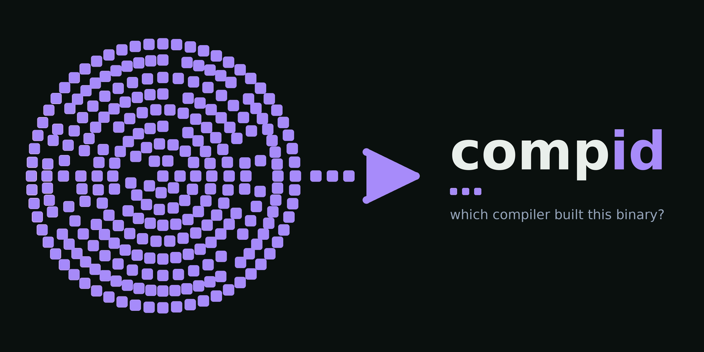
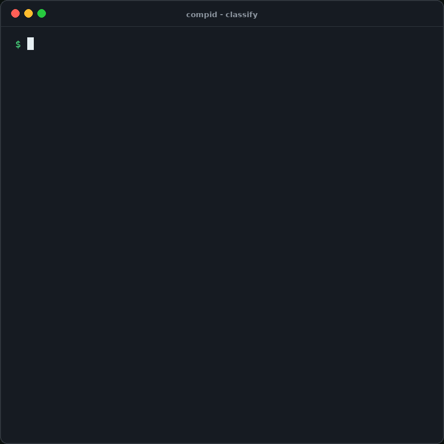
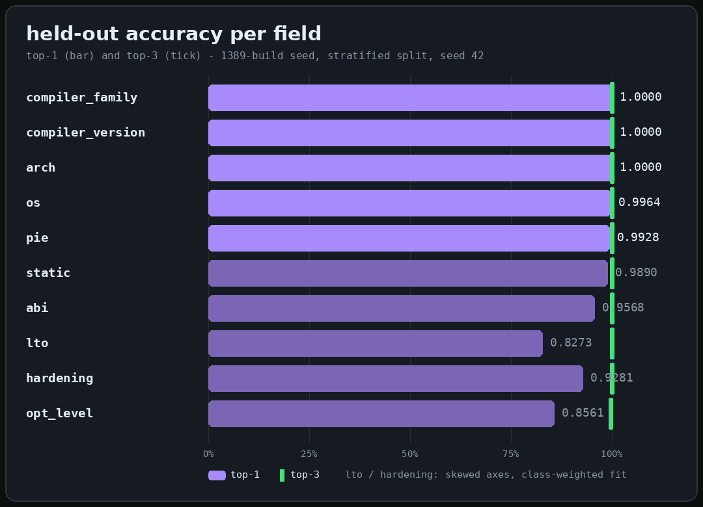
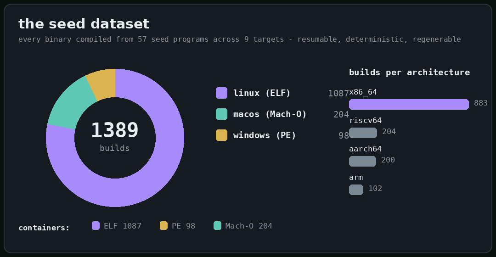
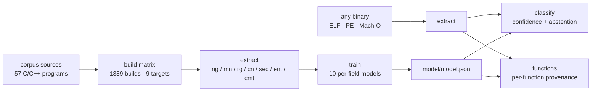

<div align="center">
  
  <h1>compid</h1>
  <p><strong>Shazam for compiled binaries - which compiler built this binary?</strong></p>
  <p>
    <a href="https://github.com/RXVEN-1907/compid/actions/workflows/ci.yml"></a>
    <a href="LICENSE"></a>
    <a href="https://www.rust-lang.org"></a>
    <a href="https://github.com/RXVEN-1907/compid/commits"></a>
  </p>
</div>

---

You hand `compid` a binary - possibly stripped, possibly renamed, possibly
deliberately anonymous - and it hands back an estimate of how that binary was
built: **compiler family, compiler version, optimization level, architecture,
OS, libc flavor, PIE, LTO, static linking, and hardening** - ten label fields,
each with a confidence score, each grounded in a build-fingerprint dataset the
project generates itself.

<div align="center"></div>

*The real output for a seed binary (gcc 13.3.0, -O0, no-PIE) - every field
lands correctly.*

## Why it exists

"Which compiler built this?" is step zero for a surprising amount of work:

- **Malware triage.** A sample set that consistently looks like gcc `-O2`
  builds tells you something about who made it and what tooling to expect
  next.
- **Reverse engineering.** Knowing the compiler, optimization level, and libc
  picks the right signatures, the right decompiler settings, and the right
  assumptions about calling conventions before you touch a function.
- **Reproducible-build forensics.** Given two artifacts claimed to come from
  the same source tree, provenance estimates are a cheap first check that the
  toolchains involved line up.
- **Mixed-binary audits.** Modern binaries are stitched together from
  vendored libraries built by different toolchains - `compid` reads them
  function by function.

Today that question is answered by hand: eyeballing prologues, string scraps,
and section layouts. `compid` turns the habit into a measured, reproducible
guess that costs one command - and it tells you how confident it is, which is
the part a hunch never does.

## Quickstart

Rust 1.75 or newer, on Linux or macOS.

```console
$ cargo install --path .
$ compid classify /bin/ls
$ compid report /bin/ls          # one rich screen: classify + why + provenance
$ compid model-info              # what the shipped model knows and how fresh it is
```

Tables render in color automatically in terminals (lavender confidence bars,
green winners) and respect the [`NO_COLOR`](https://no-color.org) standard;
`--color never` forces plain output for scripts and pipes.

## What it learns

<div align="center"></div>

Held-out metrics on the 1389-build seed (80/20 stratified split, seed 42):

| field | classes | top-1 | top-3 |
|-------|---------|-------|-------|
| compiler_family | 2 | 1.0000 | 1.0000 |
| compiler_version | 2 | 1.0000 | 1.0000 |
| arch | 4 | 1.0000 | 1.0000 |
| os | 3 | 0.9964 | 1.0000 |
| pie | 3 | 0.9928 | 1.0000 |
| static | 3 | 0.9424 | 1.0000 |
| abi | 3 | 0.9568 | 1.0000 |
| lto | 2 | 0.8273 | 1.0000 |
| hardening | 2 | 0.9281 | 1.0000 |
| opt_level | 6 | 0.8561 | 0.9964 |

`arch` covers x86-64, aarch64, riscv64, and arm32; `os` separates ELF Linux,
PE Windows, and Mach-O macOS; `hardening` detects the stack-protector /
fortify / CET build flavor. Skewed axes are fitted class-weighted, and their
macro-F1 says so honestly. Full per-class breakdowns:
[`docs/EVALUATION.md`](docs/EVALUATION.md).

## The seed dataset

<div align="center"></div>

Every binary is compiled from one of 57 self-contained seed programs across a
resumable, deterministic build matrix - nine cross targets through zig's `cc`
driver plus the system gcc, with optimization, PIE, LTO, static-linking, and
hardening axes. The pipeline is the product: grow the matrix, re-extract,
retrain, and every number above refreshes from real held-out runs.

<details>
<summary><strong>Inside one fingerprint</strong></summary>

`compid extract` turns a binary into one JSON object of integer counts over
its executable sections: byte 3-grams, mnemonics, registers, immediates,
section sizes, per-section entropy, clean 64-byte disassembly windows, and
tokens from comment/note sections and import tables. One multinomial
logistic regression per label field, fitted on L2-normalized counts,
class-weighted for the skewed axes, exported as a human-readable
`model/model.json` (`compid-model/v1`) that the Rust binary scores with no
Python, no services, no network.

</details>

<details>
<summary><strong>Function-level provenance</strong></summary>

Real binaries are stitched together from vendored libraries built by
different toolchains. `compid functions <BIN>` reads the symbol table
(unstripped ELF), the export table (PE DLLs), or a measured prologue +
call-target scan (stripped x86-64 ELF) and predicts provenance **per
function** - so a binary assembled from half gcc and half zig reads as
exactly that:

```console
$ scripts/mixed_demo.sh
gcc half: 4 functions -> gcc=4
zig half: 6 functions -> clang=6
MIXED-DEMO SPLIT OK
```

The stripped-binary boundary detector is measured against symbol ground
truth rather than promised: pooled precision 0.98 / recall 0.87 / F1 0.95
on a stratified 40-binary sweep. Per-function models: hold-out
compiler-family top-1 0.9970 per function, 0.9950 by build majority.

</details>

<details>
<summary><strong>All ten subcommands</strong></summary>

| command | what it does |
|---------|--------------|
| `compid classify <BIN>` | per-field softmax predictions, top-3 with confidence bars, `--json`, abstention flagging below `--confidence-threshold` (default 0.6) |
| `compid report <BIN>` | one rich screen: classification, why, provenance |
| `compid explain <BIN>` | the top contributing features behind each predicted class |
| `compid functions <BIN>` | per-function provenance (symbol table, export table, or measured prologue + call-target scan for stripped x86-64); `--measure` scores the boundaries |
| `compid compare <A> <B>` | cosine similarity between two fingerprints |
| `compid extract <BIN>` | the raw feature JSON (trainer input) |
| `compid functions-batch <MANIFEST>` | per-function extraction across the dataset |
| `compid batch <MANIFEST>` | whole-binary extraction across the dataset |
| `compid dataset-info` | label distributions from the manifest |
| `compid model-info` | fields, classes, and dataset provenance of a model file |

</details>

## How it works



The inference path is a single Rust binary: it parses the container with
[goblin](https://docs.rs/goblin), disassembles with
[yaxpeax-x86](https://docs.rs/yaxpeax-x86), and scores a compact
`model.json` you can read with a text editor. Robustness is tested, not
hoped for: a deterministic 3,256-case mutation fuzzer runs every parsing
path under malformed input in CI, and five overflow panics found that way
are fixed and regression-pinned.

## How compid compares

FLIRT, from IDA Pro, answers a related but different question - which
*library function* is this - by matching byte signatures against IDA's own
library packs, and it lives inside IDA. BinDiff *diffs* two binaries you
already know something about; it does not guess provenance. The academic
compiler-fingerprinting literature produces interesting datasets, but they
are research artifacts: frozen at publication time, rarely maintained, and
seldom shipped as a tool you can run on yesterday's sample. `compid` makes a
different bet: generate the dataset from the toolchains you actually care
about, keep the model small and interpretable, and make the whole loop -
build, extract, train, classify - something you can re-run end to end.

## Releases

Tag a version (`git tag v0.2.0 && git push --tags`) and the release
workflow builds x86-64 and aarch64 tarballs with the binary, shell
completions for bash/zsh/fish/PowerShell, the man page, and docs -
byte-reproducibly, with sha256 checksums.

## Contributing

The dataset grows the same way the code does: add a toolchain or target to
the matrix, rebuild, re-extract, retrain, and commit the refreshed manifest,
features, and model together. See
[CONTRIBUTING.md](CONTRIBUTING.md) and the
[roadmap](docs/roadmap.md) - function-level provenance for PE/Mach-O,
warm-started model blending, and calibration curves are the open fronts.

## License

Dual-licensed under [MIT OR Apache-2.0](LICENSE), your choice.
