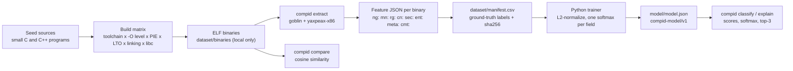

# Architecture

compid answers one question - "how was this binary built?" - with a
deliberately small pipeline. Everything runs locally, in two languages chosen
for the job they do: Rust where portability and a tight, dependency-free
runtime matter (extraction and inference), Python where iteration speed
matters (corpus building and training).

## Pipeline at a glance



## Stage 1 - the build matrix

The corpus builder (Python, `corpus/`) first discovers which toolchains the
build machine actually has - the system gcc, and when zig is available, a
zig `cc` driver that extends the matrix with musl, aarch64, and other
cross-targets. It then compiles every seed source under every flag
combination that toolchain supports: optimization levels (`-O0` through
`-O3`, `-Os`), PIE on/off, LTO on/off, static versus dynamic linking, and
libc flavor (gnu, musl). Each binary becomes one row in
`dataset/manifest.csv` with the ground-truth labels recorded straight from
the build command - nobody inspects the binary to guess what built it.

The matrix is seeded, not exhaustive. Whatever this machine could build on
the day of the run is what the dataset holds, and the tooling to widen it is
the same tooling (see `docs/dataset.md`).

## Stage 2 - extraction

`compid extract` (Rust) reads the ELF with [goblin](https://docs.rs/goblin)
and disassembles `.text` with [yaxpeax-x86](https://docs.rs/yaxpeax-x86),
emitting one JSON object of integer counts per binary. The feature families:

| prefix         | feature                                          | why it separates builds                                                              |
|----------------|--------------------------------------------------|--------------------------------------------------------------------------------------|
| `ng:`          | three-byte hex n-grams over `.text`              | each code generator has a recognizable byte-level texture                            |
| `mn:`          | mnemonic counts from disassembly                 | `-O0` shuffles through `mov`/`push`; optimized code leans on `lea`, `cmov`, `setcc` |
| `rg:`          | register mention counts                          | register-allocation habits differ per compiler and optimization level                |
| `cn:`          | 32-bit immediates, hex-encoded                   | constants that specific toolchains embed (offsets, sizes, magic numbers)             |
| `sec:`         | log2 of each section's size                      | section layout follows the linker and the flags                                      |
| `ent:`         | per-section entropy, integer 0-8                 | plain code, high-entropy data, or compressed content are easy to tell apart          |
| `meta:windows` | 64-byte sliding windows that disassemble cleanly | aligned, compiler-emitted code disassembles cleanly; packed or mixed content does not |
| `cmt:`         | tokens from comment and note string sections     | `.comment` often names the compiler and version outright                             |

Counts are integer tf values over the `.text` section. The JSON holds no
normalized numbers: L2 normalization happens at train time and at infer time,
where it is used. The exact schema is specified in `docs/dataset.md`.

## Stage 3 - labels

One label field per question, all recorded at build time:

| field              | question                       | typical seed values            |
|--------------------|--------------------------------|--------------------------------|
| `compiler_family`  | which code generator           | `gcc`, `clang`                 |
| `compiler_version` | which version of it            | `13.3.0`, `19.1.5`, ...        |
| `opt_level`        | optimization level             | `O0`, `O1`, `O2`, `O3`, `Os`  |
| `arch`             | target architecture            | `x86-64`, `aarch64`            |
| `os`               | target OS                      | `linux`                        |
| `abi`              | libc / ABI flavor              | `gnu`, `musl`                  |
| `pie`              | position-independent?          | `yes`, `no`                    |
| `lto`              | link-time optimized?           | `yes`, `no`                    |
| `static`           | statically linked?             | `yes`, `no`                    |

The seed grows with the matrix; a field only gets the classes its dataset
actually contains.

## Stage 4 - training

The Python trainer (`training/`) reads the manifest and the feature files,
L2-normalizes every count vector, and fits one multinomial logistic
regression (softmax) per label field, independently. The choice of a linear
model is not a placeholder for something fancier; it is the point:

- The seed dataset is small - hundreds to low thousands of rows. Linear
  models trained on n-gram counts are hard to overfit at that scale.
- A softmax is trivial to reimplement in Rust: one intercept and one weight
  vector per class. Inference needs no Python, no ONNX runtime, no shared
  library.
- The model is one readable JSON file. You can diff two models and see what
  changed.

## Stage 5 - inference

`compid classify` and `compid explain` extract features the same way, keep
only the feature names the model knows (missing names count as zero),
L2-normalize, and compute for every class `c` of every field:

```text
score(c) = intercept(c) + dot(coef(c), x)
```

A softmax over the scores turns them into per-field probabilities, and the
CLI reports the top-3 classes with their confidence. The exact algorithm,
with the exact `model.json` schema, is `docs/model-format.md`.

`compid compare` skips the model entirely and answers a simpler question -
how similar are these two binaries' fingerprints - with the cosine similarity
of their L2-normalized feature vectors.

## On-disk layout

| path                   | committed               | contents                                   |
|------------------------|-------------------------|--------------------------------------------|
| `dataset/manifest.csv` | yes                     | one row per built binary                   |
| `dataset/binaries/`    | no (gitignored)         | the binaries themselves                    |
| `dataset/features/`    | yes, after a training run | extracted feature JSON, one object per line (`train.jsonl`) |
| `model/model.json`     | yes                     | the trained model (`compid-model/v1`)      |

## Design choices worth defending

- **Integer counts in the JSON, normalization at use time.** Integer JSON is
  portable, diffable, and stable across platforms; normalization is a
  one-liner on both sides, done identically by the trainer and the CLI.
- **One model file, no server.** `model.json` is a static asset that ships
  with the repo. Classification is a dot product; a service would be theater.
- **Softmax over something exotic.** With small seed data, a linear model
  gives calibrated-ish probabilities and an honest signal when it is unsure;
  a bigger model would mostly be memorizing the build matrix.
- **Rust for the hot path, Python for the cold path.** The CLI must run
  anywhere, on stripped machines, offline. The trainer runs twice a month on
  a build box and can afford scikit-style iteration.
